[C#言語2026 第17回]

# ボス敵とステージクリア

 27. 得点を表示する
 28. 敵出現テーブルを作る
 29. 敵の種類を増やす(X座標ランダム、左右から発生、大量に発生、追尾)
 30. ボスを出す
 31. ボスの動きを作る
 32. 砲塔のオフセット
 33. 砲塔の発射開始時間
 34. ボスを破壊する(ステージクリア)
 35. 次のステージを作る

## キーポイント

* 
* 
* 
* 

## 1 敵の発生を制御する

&emsp;1回目: 背景の表示、敵の表示、敵のクラス化、敵を増やす<br>
&emsp;2回目: 流れる星の表示、敵を動かす、敵の発生を制御する、敵の行動パターンを増やす<br>
&emsp;3回目: 自機の表示、弾丸を発射する、敵と弾丸の衝突判定、爆発を表示<br>
&emsp;4回目: 自機のパワーアップ、敵の弾丸を発射する、自機と敵の弾丸の衝突判定、ゲームオーバー、敵の調整<br>
&emsp;**今回: 得点の表示、敵出現順の制御、ボス敵の表示、レベルクリア、レベルを増やす**

### 1.1 敵発生装置の表を作る

敵をランダムに発生させる方法の長所は「さまざまな状況を自動的に作り出せる」ことです。<br>
ですが、それは「面白いゲーム展開になるかどうかは運次第」ということも意味します。<br>
ランダムを使うだけでは、安定して「面白いゲーム展開」を生み出すのは難しいです。

そのため、大半のシューティングゲームでは、発生する敵の種類や場所を事前に決めています。<br>
どの程度厳密に決めるかはゲームの設計思想によります。種類や場所を完全に決めているゲームもあります。<br>
おおよその位置や順序だけ決まっていて、多少のランダム性を持つゲームもあります。

ランダムの使用率が違っても、敵発生の仕組みには「敵発生表」が使われています。<br>
「敵発生表」は、以下のデータを表にまとめたものです。

* 敵を発生されるタイミング
* 敵を発生させる位置
* 発生させる敵(または敵発生パターン)の種類

これらを表にまとめる方法はゲームによって異なります。<br>
例えば、ひとつひとつの敵を丁寧に手作業で配置することもできますが、手間がかかります。<br>
そこまでの手間は掛けたくないです。

そこで、今回は敵発生装置を大まかに配置して、細かい部分はランダムに任せることにします。<br>
配置は、画面を縦に5分割して、それぞれに敵の発生パターンを指定する形式にしましょう。

表には、敵発生装置を作成する座標と、５個の敵のパターン番号が含まれます。この表は次のようになるでしょう。

| 作成する座標 |左端| 左 |中央| 右 |右端|
|------------:|:--:|:--:|:--:|:--:|:--:|
|         200 |  - |  1 |  - |  2 |  - |
|         650 |  - |  - |  3 |  - |  - |
|         800 |  2 |  - |  - |  - |  1 |
|        1000 |  - |  4 |  5 |  4 |  - |
|         ︙  | ︙ |  ︙ | ︙ | ︙ | ︙ |

この表を管理して、敵発生装置を作成するクラスを作りましょう。<br>
クラス名は`EventTable`(イベント・テーブル、「出来事の表」という意味)とします。<br>
「敵発生装置を作るという出来事が、いつどこで起きるかを表にしたもの」というイメージで名付けました。

それでは、以下の手順にしたがって、プロジェクトに`EventTable.cs`を追加してください。

1. ソリューションエクスプローラーのプロジェクト名(今回の場合は`ShootEmUp`)を右クリック
2. 「追加」項目にマウスカーソルを合わせる
3. 「新しい項目」を左クリック(「新しい項目の追加」というウィンドウが開く)<br>
4. ウィンドウ中央の空欄(`FileName.cs`となっている部分)を`EventTable.cs`に書き換える
5. 「追加」ボタンをクリック

まずは変数とコメントを追加しましょう。<br>
表のような二次元のデータを扱うには、二次元の配列を使います。<br>
二次元の氷を作るには、配列変数を宣言するとき、`int[,]`のように`[]`の中に記号`,`(カンマ)を入れます。

`EventTable`クラスの定義を、次のように変更してください。

```diff
 using System;
 using System.Collections.Generic;
 using System.Linq;
 using System.Text;
 using System.Threading.Tasks;
 
 namespace ShootEmUp
 {
+  // イベント(敵発生装置を作るとか)の表を管理するクラス
   internal class EventTable
   {
-  }
-}
+    // レベル0のイベント表
+    //   { 発生させる座標, 左端のパターン, 左, 中央, 右, 右端 }
+    //   パターン番号 -1 は「イベントなし」の意味
+    private static readonly int[,] tableLevelZero = {
+      {  100, -1,  0, -1,  0, -1 },
+      {  300, -1, -1,  1, -1, -1 },
+      {  500,  2, -1, -1,  1, -1 },
+      {  700, -1,  4, -1,  4, -1 },
+      {  900,  0, -1, -1,  2, -1 },
+      { 1100, -1, -3, -1, -1,  0 },
+    };
+
+    public int Index; // 参照する行の番号
+    public Random rand = new(); // 乱数
+  } // EventTable 型ブロックの終わり
+} // ShootEmUp 名前空間ブロックの終わり
```

二次元配列は、横一列に並んだデータを１行として、行を複数並べた形になります。

### 1.2 コンストラクタを作る

次にコンストラクタを書きます。<br>
変数宣言の下に、次のプログラムを追加してください。

```diff
       { 1000, -1, -1,  3, -1, -1 },
     };

     public int Index;   // 参照する行の番号
     public Random Rand; // 乱数
+
+    // コンストラクタ
+    {
+      Index = 0;
+      Rand = new();
+    } // コンストラクタブロックの終わり
   } // EventTable 型ブロックの終わり
 } // ShootEmUp 名前空間ブロックの終わり
```

### 1.3 表クラスを更新するメソッドを作る

続いて、`EventTable`の状態を更新するメソッドを書きます。<br>
名前は`Update`(アップデート、「更新する」という意味)とします。

`Update`メソッドのパラメータは「Y座標」と「敵発生装置のリスト」です。<br>
パラメータのY座標が、表に書かれたY座標以上になったら、表に従って敵発生装置を作成します。

コンストラクタブロックの下に、次のプログラムを追加してください。

```diff
     // コンストラクタ
     {
       Index = 0;
       Rand = new();
     } // コンストラクタブロックの終わり
+
+    // 敵発生表の状態を更新する
+    public void Update(float y, List<EnemySpawner> enemySpawnerList)
+    {
+      // イベント表を選択
+      int[,] table = tableLevelZero;
+
+      //行番号が表の行数以上、またはスクロール座標が現在の行のY座標未満なら何もしない
+      if (Index < table.GetLength(0) || y < table[Index, 0])
+      {
+        return;
+      }
+
+      // スクロール座標が現在の行のY座標を超えたので、敵発生装置を作成する
+      for (int a = 1; a < 6; a += 1)
+      {
+        int pattern = table[Index, a];
+
+        // パターン番号が0以上の場合だけ敵発生装置を作成する
+        if (pattern >= 0)
+        {
+          // 区切りの間のどこかに敵発生装置を作成
+          int[] rangeList = { 0, 62, 242, 422, 602, 882, 962 }; // X座標の区切り
+          float x = Rand.Next(rangeList[a], rangeList[a + 1]);
+          enemySpawnerList.Add(new(x, -32, pattern));
+        }
+      }
+      Index += 1; // 表の次の行へ進む
+    } // Update メソッドブロックの終わり
   } // EventTable 型ブロックの終わり
 } // ShootEmUp 名前空間ブロックの終わり
```

二次元配列の「行(ぎょう)」と「列(れつ)」の長さを調べるには、`GetLength`(ゲット・レングス、「長さを得る」という意味)メソッドを使います。<br>
`GetLength(0)`のように、パラメータに`0`を指定すると「行数」が得られます。`1`を指定すると「列数」が得られます。

これで、`EventTable`クラスは完成です。

### 1.4 イベント表を使う

それでは、敵発生装置を作るプログラムを、完全ランダムから表を使う方法に変えましょう。<br>
`Form1`を開き、敵の変数を次のように変更してください。

```diff
     // 敵の変数
     private List<Enemy> enemyList = new();
     private List<Bullet> enemyBulletList = new(); // 敵の弾丸のリスト
     private List<EnemySpawner> enemySpawnerList = new(); // 敵発生装置のリスト
-    private float enemySpawnTimer = 0.0f; // 敵発生タイマー
+    private EventTable eventTable = new(); // イベント表

     // 自機の変数
     private Player player = new(RenderWidth * 0.5f, RenderHeight * 0.75f);
     private List<Bullet> playerBulletList = new();
```

次に、`UpdatePlay`メソッドにある「敵を発生させる」プログラムを、次のように変更してください。

```diff
         enemyBulletList[a].Update(deltaTime);
       }
       enemyBulletList.RemoveAll((e) => { return e.IsFinished; });

       // 敵を発生させる
-      enemySpawnTimer += deltaTime;
-      if (enemySpawnTimer >= 1.0f)
-      {
-        enemySpawnTimer -= 1.0f; // 敵発生タイマーの時間を戻す
-
-        float x = rand.Next(32, RenderWidth - 32); // 発生位置のX座標
-        int pattern = rand.Next(5); // 発生パターン
-        enemySpawnerList.Add(new(x, -32, pattern));
-      }
+      float scrollLength = bmpBackground.Height - RenderHeight; // スクロールする高さ
+      float scrollY = scrollLength + backgroundY; // スクロールした長さ
+      eventTable.Update(scrollY, enemySpawnerList);

       // 敵発生装置を更新する
       for (int a = 0; a < enemySpawnerList.Count; a += 1)
```

`scrollLength`(スクロール・レングス、「移動する長さ」)は、背景を移動させる長さをあらわします。<br>
`scrollY`(スクロール・ワイ)は、現在のフレームまでに移動した長さをあらわします。<br>
この`scrollY`を、イベント表のY座標の数値と比較することで、敵発生装置を作成します。

続いて、`UpdateDead`メソッドの`enemySpawnTimer`の初期化を削除してください。

```diff
         // 敵のデータを初期化する
         enemyList.Clear();
         enemySpawnerList.Clear();
         enemyBulletList.Clear();
-        enemySpawnTimer = 0.0f;

         // 自機のデータを初期化する
         player.Character.X = RenderWidth * 0.5f;
         player.Character.Y = RenderHeight * 0.75f;
```

プログラムが書けたら`>ShootEmUp`ボタンをクリックしてアプリを実行してください。<br>
表に書いた順番で敵が出現したら成功です。

<div align="center">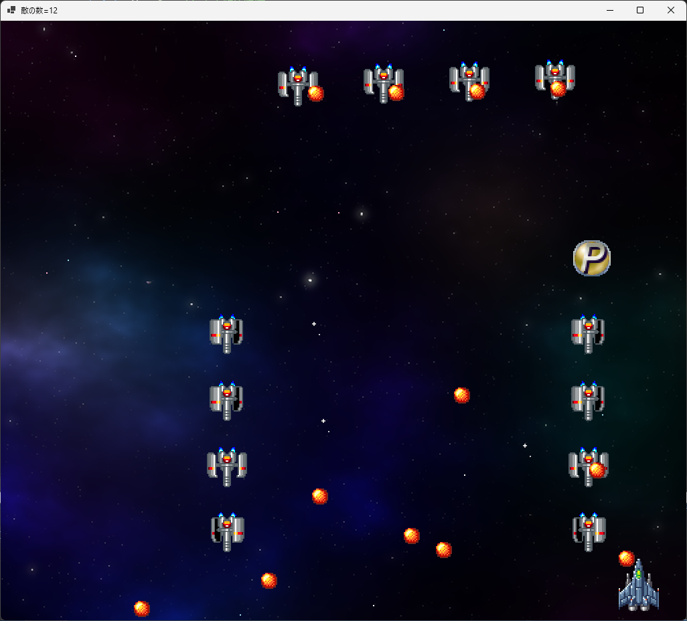</div>

<pre class="tnmai_assignment">
<strong>【課題01 表の行数を増やす】</strong>
以下の図を参考に、<code>tableLevelZero</code>の内容を変更しなさい。
<table>
<tr><th>Y座標</th><th>左端</th><th>左</th><th>中</th><th>右</th><th>右端</th></tr>
<tr><td> 100</td><td>-1</td><td>0</td><td>-1</td><td>0</td><td>-1</td></tr>
<tr><td> ︙</td><td>︙</td><td>︙</td><td>︙</td><td>︙</td><td>︙</td></tr>
<tr><td>1100</td><td>-1</td><td>3</td><td>-1</td><td>-1</td><td> 0</td></tr>
</table>&emsp;&emsp;&emsp;&emsp;(ここから下を追加)
<table>
<tr><td>1300 </td><td> 4&emsp;</td><td>1&nbsp;</td><td>-1</td><td>-1</td><td> 4&emsp;</td></tr>
<tr><td>1500</td><td>-1</td><td>1</td><td>-1</td><td> 3</td><td>-1</td></tr>
<tr><td>1700</td><td>-1</td><td>1</td><td>-1</td><td>-1</td><td> 0</td></tr>
<tr><td>1900</td><td> 0</td><td>1</td><td>-1</td><td> 1</td><td>-1</td></tr>
<tr><td>2100</td><td> 4</td><td>1</td><td>-1</td><td>-1</td><td> 4</td></tr>
<tr><td>2200</td><td>-1</td><td>4</td><td>-1</td><td> 4</td><td>-1</td></tr>
<tr><td>2300</td><td>-1</td><td>1</td><td> 3</td><td>-1</td><td>-1</td></tr>
<tr><td>2400</td><td>-1</td><td>0</td><td>-1</td><td> 0</td><td>-1</td></tr>
</table></pre>

<div style="page-break-after: always"></div>

## 2 得点と命中エフェクト

### 2.1 得点を作る

ゲームの目的は「レベルをクリアすること」です。敵を倒すのは「手段」に過ぎません。<br>
極論、弾丸を１発も撃たなくてもレベルをクリアできます。

ですが、シューティングゲームなんですから、弾丸を発射して敵を倒してもらいたいものです。<br>
そこで、敵を倒すと得点が入るようにして、高得点を目指す遊び方ができるようにしましょう。

メリハリを付けるため、簡単に倒せる敵は得点を低めに、倒しにくい敵は得点を高めにしたいです。<br>
そこで、`Enemy`クラスに「敵の種類に対応する得点」を返すメソッドを追加します。<br>
メソッド名は、`GetScore`(ゲット・スコア、「得点を取得」という意味)とします。

`Enemy.cs`を開き、`Draw`メソッドブロックの下に、次のプログラムを追加してください。

```diff
     // 敵を描く
     public void Draw(Graphics g, Bitmap bmp)
     {
       Character.Draw(g, bmp);
     } // Draw メソッドブロックの終わり
+
+    // 敵の得点を取得
+    public int GetScore()
+    {
+      if (Type == MediumRed)
+      {
+        return 800;
+      }
+      else if (Type == MediumBlue)
+      {
+        return 1000;
+      }
+      return 100;
+    } // GetScore メソッドブロックの終わり
   } // Enemyクラスブロックの終わり
 } // ShootEmUp 名前空間ブロックの終わり
```

次に、「獲得した得点をあらわす変数」を追加します。<br>
変数名は`score`(スコア、「得点」という意味)とします。
`Form1`を開き、自機の変数を宣言するプログラムに、「得点」をあらわす変数を追加してください。<br>

```diff
     // 自機の変数
     private Player player = new(RenderWidth * 0.5f, RenderHeight * 0.75f);
     private List<Bullet> playerBulletList = new();
     private List<Item> itemList = new();
+    private int score = 0; // 得点

     // 爆発などのエフェクトのリスト
     private List<Character> effectList = new();
```

それでは、敵を倒したときに、`score`変数の数値を増やしましょう。<br>
`UpdatePlay`メソッドにある「敵と自機の弾丸の衝突判定」に、得点を増やすプログラムを追加してください。

```diff
           // HPが0以下になった敵を破壊する
           if (enemy.Hp <= 0)
           {
+            score += enemy.GetScore(); // 得点を増やす
             enemy.IsFinished = true; // 敵を終了状態にする

             // 爆発エフェクトを追加する
             Character c = new(x, y, animeSmallBlast, 15);
             c.AnimeIsLoop = false; // 一度だけ再生する
```

これで、敵を倒すと得点が増えるようになりました。

### 2.2 得点を表示する

得点を画面に表示して、プレイヤーが何点取れたか分かるようにしましょう。<br>
まず得点用のフォントを追加します。<br>
`Form1`を開き、フォント変数を宣言するプログラムに、次のプログラムを追加してください。

```diff
     // フォント変数
     private Font fontHeading = null !; // 見出し用フォント
+    private Font fontScore = null !;   // 得点用フォント

     // ファイルから画像を読み込む
     private Bitmap bmpBackground = new("assets/images/bg_space.png");
     private Bitmap bmpObjects = new("assets/images/tile_objects.png");
```

次にフォントを読み込みます。`Init`メソッドに次のプログラムを追加してください。

```diff
     public void Init()
     {
       // フォントを作成
       float dpiScale = 96.0f / DeviceDpi;
       fontHeading = new("Impact", 64 * dpiScale);
+      fontScore = new("Verdana", 28 * dpiScale, FontStyle.Italic);
 
       // 背景のY座標を、一番下の1画面がちょうどウィンドウ内に表示されるように設定
       backgroundY = -(bmpBackground.Height - RenderHeight);
```

今回は`Verdana`(ヴァーダナ)フォントを斜体にして使ってみます。<br>

> `Verdana`はWindows 95の頃から標準で搭載されているフォントです。<br>
> 「ディスプレイに表示したときの読みやすさ」を意識して作られています。

それでは、作成したフォントを使って得点を表示しましょう。<br>
`PaintPlay`メソッドにある「敵の弾丸を描く」プログラムの下に、得点を表示するプログラムを追加してください。

```diff
       // 敵の弾丸を描く
       for (int a = 0; a < enemyBulletList.Count; a += 1)
       {
         enemyBulletList[a].Draw(g, bmpObjects);
       }
+
+      // 得点を描く
+      TextRenderer.DrawText(g, score.ToString(), fontScore, new Point(128, 16), Color.White);
     } // PaintPlay メソッドブロックの終わり

     // クリア状態を描く
     private void PaintClear(Graphics g)
```
`ToString`(トゥ・ストリング、「文字列にする」という意味)メソッドは、`int`型の数値を文字列に変換します。

プログラムが書けたら`>ShootEmUp`ボタンをクリックしてアプリを実行してください。<br>
ウィンドウの左上に得点が表示されたら成功です。

<div align="center">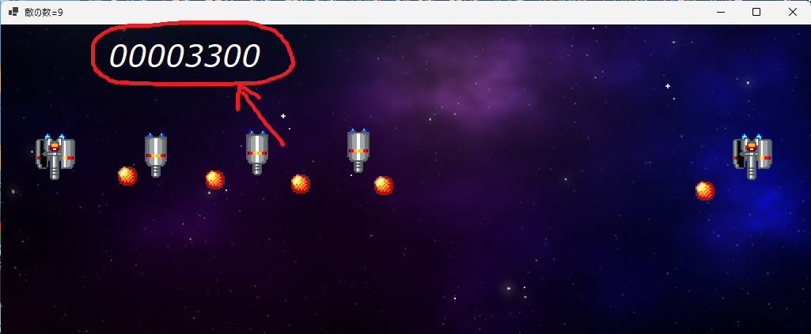</div>

### 2.3 得点をリセットする

ゲームオーバーになって再開すると、得点が以前のままになっていることに気づくでしょう。<br>
これでは、何度も繰り返しプレイするだけで、誰でも高得点が取れてしまいます。<br>
そこで、ゲームオーバーから再開するときに得点を`0`に戻しましょう。

`UpdateDead`メソッドにある「自機のデータを初期化する」プログラムに、得点をリセットするプログラムを追加してください。

```diff
       // 自機のデータを初期化する
       player.Character.X = RenderWidth * 0.5f;
       player.Character.Y = RenderHeight * 0.75f;
       player.ShotLevel = 0;
       playerBulletList.Clear();
+      score = 0; // 得点をリセットする

       // その他のデータを初期化する
       itemList.Clear();
       effectList.Clear();
```

プログラムが書けたら`>ShootEmUp`ボタンをクリックしてアプリを実行してください。<br>
ゲームオーバーになってゲームを再開したとき、得点が`0`に戻っていれば成功です。

### 2.4 弾丸が当たったときに得点を増やす

中型の敵は、弾丸を何発も撃ち込まないと倒せません。<br>
倒せなくても撃ち込む意義が生まれるように、弾丸が当たったら得点を`10`増やしましょう。<br>
`UpdatePlay`メソッドにある「HPが0以下になった敵を破壊する」ifブロックの下に、次のプログラムを追加してください。

```diff
           // 爆発エフェクトを追加する
           Character c = new(x, y, animeSmallBlast, 15);
           c.AnimeIsLoop = false; // 一度だけ再生する
           effectList.Add(c);

           break; // 弾丸のループを終了する
         }
+        else
+        {
+          // 敵のHPが残っている場合
+          score += 10; // 得点を少し増やす
+        }
       }
     } // playerBulletList のforブロックの終わり
   } // enemyList のforブロックの終わり
```

プログラムが書けたら`>ShootEmUp`ボタンをクリックしてアプリを実行してください。<br>
中型の敵に弾丸を当てたとき、得点が10ずつ増えていたら成功です。

<div align="center">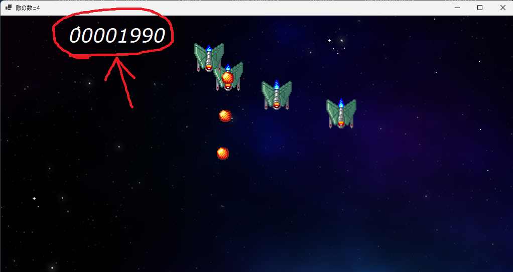</div>

### 2.5 命中エフェクトを表示する

弾丸が当たると得点が入るなら、弾丸が当たったことが分かるようにエフェクトを表示するべきでしょう。<br>
まずはエフェクトのアニメーション範囲を作成しましょう。<br>
アニメーション範囲の名前は`animeHitEffect`(アニメ・ヒット・エフェクト、「命中エフェクトのアニメ」という意味)とします。

「中くらいの爆発のアニメーション範囲」の宣言の下に、命中エフェクトのアニメーション範囲を追加してください。

```diff
     private static Rectangle[] animeMediumBlast = {
       new(832, 384, 16, 16), new(800, 368, 32, 32), new(752, 368, 48, 48),
       new(704, 368, 48, 48), new(656, 368, 48, 48),
     };
+
+    // 弾丸の命中エフェクトのアニメーション範囲
+    private static Rectangle[] animeHitEffect = {
+      new(32, 464, 16, 16), new(48, 464, 16, 16),
+      new(64, 464, 16, 16), new(80, 464, 16, 16),
+    };

     // 乱数
     private Random rand = new();
```

次に、敵に弾丸が命中しても「HPが残っている」場合のプログラムに、「命中エフェクトを表示」するプログラムを追加してください。

```diff
           break; // 弾丸のループを終了する
         }
         else
         {
           // 敵のHPが残っている場合
           score += 10; // 得点を少し増やす
+
+          // 命中エフェクトを表示
+          Character c = new(bullet.Character.X, bullet.Character.Y - 16, animeHitEffect, 20);
+          c.AnimeIsLoop = false;
+          effectList.Add(c);
         }
       }
     } // playerBulletList のforブロックの終わり
   } // enemyList のforブロックの終わり
```

Y座標を`弾丸のY座標 - 16`にしたのは、命中エフェクトを「弾丸の先端部分」に表示するためです。

プログラムが書けたら`>ShootEmUp`ボタンをクリックしてアプリを実行してください。<br>
中型の敵に弾丸を当てたとき、小さな命中エフェクトが表示されたら成功です。

<div align="center">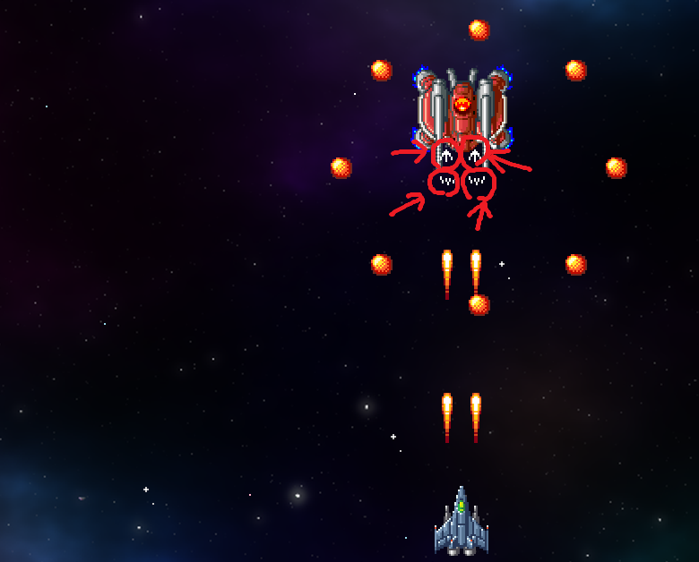</div>

<div style="page-break-after: always"></div>

## 3 ボス・キャラクターを出す

### 3.1 ボスキャラの見た目と番号を決める

シューティングゲームで盛り上がる場面といえは、レベルの最後に待ち受ける強力な敵、いわゆる「ボスキャラ」との戦いです。<br>
今どきのゲームとしては、ボスキャラを避けて通るわけにはいきません。ボスキャラを作成しましょう。<br>
ボスキャラ作成は、以下の４段階で行います。

> 1. ボスキャラの見た目を作る
> 2. ボスキャラの動きを作る
> 3. ボスキャラの攻撃を作る
> 4. ボスキャラの破壊演出を作る

それでは、「ボスキャラの見た目」を作りましょう。<br>
ボスキャラの画像には、`tile_objects.png`の右上のキャラクターを使います。<br>
アニメーション範囲の変数名は`animeBoss1`(アニメ・ボス・いち、「レベル1のボスのアニメ」という意味)とします。

`Enemy.cs`を開き、小型で緑色の敵のアニメーション範囲の下に、ボスキャラのアニメーション範囲を追加してください。

```diff
     // 小型で緑色の敵のアニメーション範囲の配列
     private static Rectangle[] animeSmallGreen = {
       new(0, 176, 32, 32),
       new(32, 176, 32, 32),
       new(64, 176, 32, 32),
     };
+
+    // レベル1ボスのアニメーション範囲の配列
+    private static Rectangle[] animeBoss1 = { new(1024 - 256, 0, 256, 128) };

     // 敵の変数
     public Character Character;
     public float MoveSpeedX; // X方向の速度
```

それから、ボスキャラの種類番号を決めておきます。変数名は`Boss1`(ボス・いち)とします。<br>
敵の種類をあらわす変数宣言に、`Boss1`変数を追加してください。

```diff
     // 敵の種類
     public const int SmallGray = 0;  // 小型で灰色(スモール・グレー)
     public const int MediumRed = 1;  // 中型で赤色(ミディアム・レッド)
     public const int MediumBlue = 2; // 中型で青色(ミディアム・ブルー)
     public const int SmallGreen = 3; // 小型で緑色(スモール・グリーン)
+    public const int Boss1 = 4;      // レベル1のボス

     // コンストラクタ
     public Enemy(float x, float y, int t, Character? target)
```

ボスキャラを作るプログラムを書きましょう。<br>
コンストラクタにある、種類が`SmallGreen`の敵を作るプログラムの下に、ボスキャラを作るプログラムを追加してください。

```diff
       else if (Type == SmallGreen)
       {
         Character = new Character(x, y, animeSmallGreen, 8);
         HitboxLocal = new(-28, 28, -28, 28); // キャラ中心ラ中心の衝突判定
         MoveSpeedX = 150;
       }
+      else if (Type == Boss1)
+      {
+        Character = new Character(Form1.RenderWidth * 0.5f, -256.0f, animeBoss1, 0);
+        HitboxLocal = new(-240, 240, -96, 96); // キャラ中心の衝突判定
+        Hp = 800; // ５連装x秒間８連射のとき20秒で倒せる耐久値
+      }

       // 実際のヒットボックスを計算
       Hitbox = new(
         HitboxLocal.Left + Character.X, HitboxLocal.Right + Character.X,
         HitboxLocal.Top + Character.Y, HitboxLocal.Bottom + Character.Y);
```

ボスキャラのHPは`800`にしています。これは、自機が５連装の状態なら、20秒間攻撃し続ければ倒せる耐久値です。

### 3.2 ボスキャラの動きを作る

次はボスキャラの動きを作ります。<br>
ただ、大半のシューティングゲームのボスは大きいので、画面内を動く余地があまりありません。<br>
そのため、ゆっくり左右に反復移動するだけとか、ゆっくり楕円運動するだけということが多いです。

今回作るボスキャラも、まず中央上から下に少し移動した後は、左右を往復する程度にしておきます。<br>
まずは、下に移動するためのY方向の速度を設定します。<br>
ボスキャラを作成するプログラムに、次のプログラムを追加してください。

```diff
       else if (Type == Boss1)
       {
         Character = new Character(Form1.RenderWidth * 0.5f, -256.0f, animeBoss1, 0);
         HitboxLocal = new(-240, 240, -96, 96); // キャラ中心の衝突判定
         Hp = 800; // ５連装x秒間８連射のとき20秒で倒せる耐久値
+        MoveSpeedY = 200; // 下へ移動
       }

       // 実際のヒットボックスを計算
       Hitbox = new(
```

次に、`Update`メソッドにある「小型で緑色の敵」を動かすプログラムの下に、ボスキャラを動かすプログラムを追加してください。

```diff
         // 画面の下に消えたら行動終了
         if (Character.Y >= Form1.RenderHeight + 64)
         {
           IsFinished = true;
         }
       }
+      else if (Type == Boss1)
+      {
+        // 動作開始座標(この座標から左右移動を開始する)
+        float baseX = Form1.RenderWidth * 0.5f;
+        float baseY = 200.0f;
+
+        // 動作開始座標に到達するまで下に移動したあと、
+        // ゆっくりと左右に移動する
+        float downEndTime = 3.0f; // 下へ移動する期間
+        if (Timer < downEndTime)
+        {
+          // ボスを下へ移動
+          Character.Y += MoveSpeedY * deltaTime;
+
+          // 動作開始Y座標を超えないようにする
+          if (Character.Y >= baseY)
+          {
+            Character.Y = baseY;
+          }
+        }
+        else
+        {
+          // ボスを左右に移動
+          float t = Timer - downEndTime; // 左右移動開始からの経過秒数
+          float a = 8.0f;   // 1回の左右移動にかかる秒数
+          float b = 256.0f; // 振幅
+          Character.X = baseX + MathF.Sin(MathF.PI * 2.0f / a * t) * b;
+        }
+      }

       // 砲塔の状態を更新
       for (int a = 0; a < TurretList.Count; a += 1)
       {
```

これでボスキャラの動きは完成です。ボスを発生させて、動作を確認しましょう。<br>
それには、敵発生装置にボスキャラのパターンを追加する必要があります。

ボスキャラのパターン番号は、イベント表のなかで目立つように`99`とします。<br>
ボスキャラの発生数は1個で、上側の画面外の中央に出現させます。

`EnemySpawner.cs`を開き、コンストラクタにボスキャラの発生数を追加してください。

```diff
       Count = 4; // 基本の発生数は4つ
       if (Pattern == 2 || Pattern == 3)
       {
         // 中型の敵は発生数を2つにする
         Count = 2;
       }
+      else if (Pattern == 99)
+      {
+        // レベル1のボスの発生数を1つにする
+        Count = 1;
+      }
       Timer = 0.0f;
       IsFinished = false;
     } // コンストラクタブロックの終わり
```

`Update`メソッドにあるパターン4番の敵発生プログラムの下に、ボスを発生させるプログラムを追加してください。

```diff
       else if (Pattern == 4)
       {
         // 小型で緑色の敵を、縦方向に発生
         enemyList.Add(new(SpawnX, SpawnY, Enemy.SmallGreen, target));
         Timer += 0.25f; // 次の発生までの時間を設定
       }
+      else if (Pattern == 99)
+      {
+        // レベル1のボスを、上側の画面外中央に発生
+        enemyList.Add(new(Form1.RenderWidth * 0.5f, -256, Enemy.Boss1, target);
+      }

       Count -= 1; // 発生数を1減らす

       // 発生数が 0 になったら発生終了にする
       if (Count <= 0)
```

今回作るボスキャラの発生位置は固定で、ランダムな位置に出すつもりはありません。<br>
そのため、ボスキャラの発生位置は、パラメータを使わずに直接指定しています。

続いて、イベント表に「ボスキャラの発生装置」を追加します。<br>
`EventTable.cs`を開き、レベル1のイベント表の最初の行を、次のように変更してください。

```diff
     // レベル0のイベント表
     //   { 発生させる座標, 左端のパターン, 左, 中央, 右, 右端 }
     //   パターン番号 -1 は「イベントなし」の意味
     private static readonly int[,] tableLevelZero = {
-      {  100, -1,  0, -1,  0, -1 },
+      {  100, -1, -1, 99, -1, -1 },
       {  300, -1, -1,  1, -1, -1 },
       {  500,  2, -1, -1,  1, -1 },
       {  700, -1,  4, -1,  4, -1 },
```

プログラムが書けたら`>ShootEmUp`ボタンをクリックしてアプリを実行してください。<br>
ゲーム開始直後にボスキャラが表示され、ゆっくり左右に移動したら成功です。

<div align="center">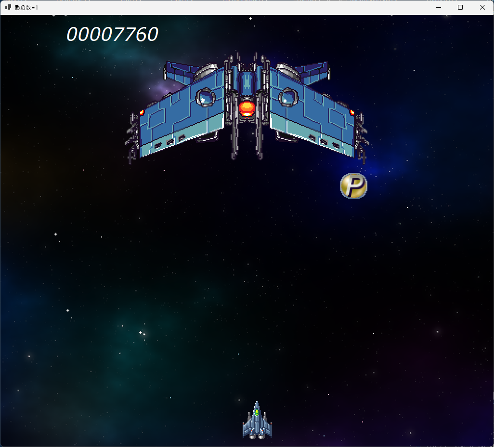</div>

### 3.3 ボスキャラに縦の動きを追加する

左右に動くだけではつまらないので、上下の動きも追加しましょう。<br>
ボスを左右に移動させるプログラムの下に、次のプログラムを追加してください。

```diff
           // ボスを左右に移動
           float t = Timer - downEndTime; // 左右移動開始からの経過秒数
           float a = 8.0f;   // 1回の左右移動にかかる秒数
           float b = 256.0f; // 振幅
           Character.X = baseX + MathF.Sin(MathF.PI * 2.0f / a * t) * b;
+
+          // ボスを上下に移動
+          Character.Y = baseY - b + MathF.Cos(MathF.PI * 2.0f / a * t) * b;
         }
       }

       // 砲塔の状態を更新
       for (int a = 0; a < TurretList.Count; a += 1)
```

プログラムが書けたら`>ShootEmUp`ボタンをクリックしてアプリを実行してください。<br>
ボスキャラが「円運動」をしながら画面上に出て行き、また戻ってきたら成功です。

<div align="center">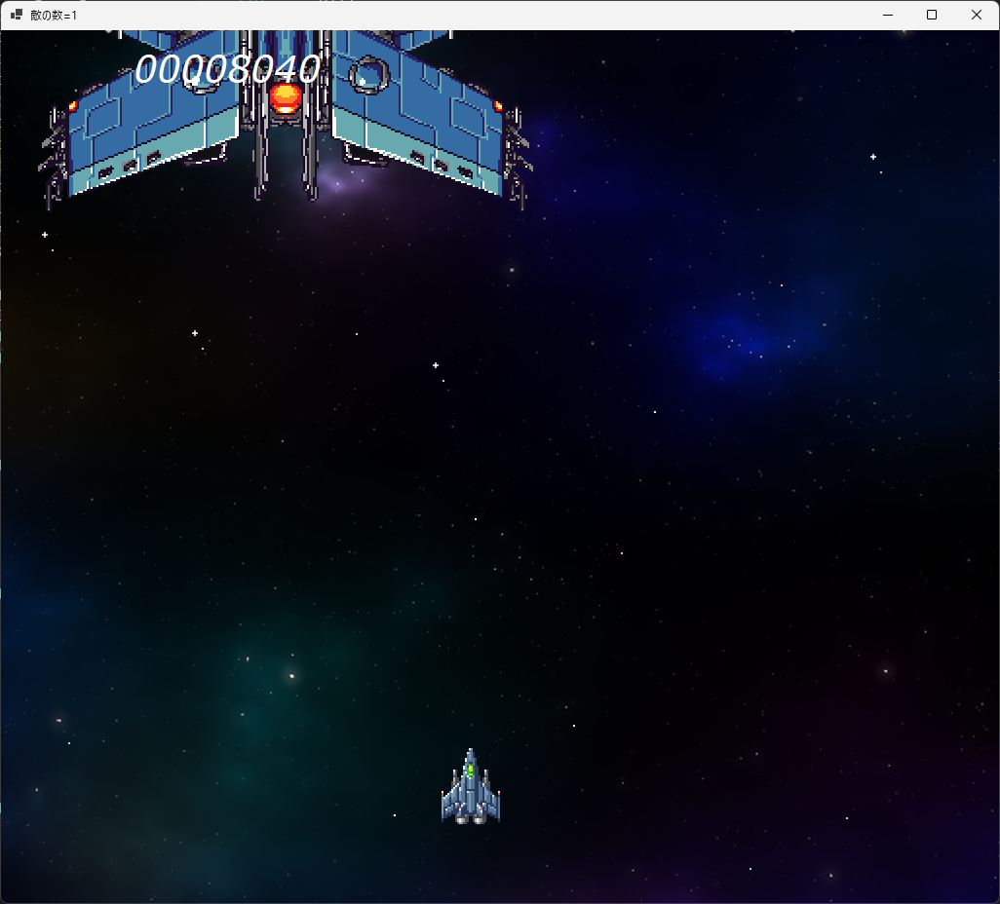</div>

### 3.4 ボスキャラの動きを楕円にする

普通の円形では、ボスキャラが画面外に見えなくなる時間ができてしまいます。<br>
そこで、上下の振幅を減らして、楕円形の動きをさせましょう。<br>
ボスを上下に移動させるプログラムに、次のプログラムを追加してください。

```diff
           // ボスを左右に移動
           float t = Timer - downEndTime; // 左右移動開始からの経過秒数
           float a = 8.0f;   // 1回の左右移動にかかる秒数
           float b = 256.0f; // 振幅
           Character.X = baseX + MathF.Sin(MathF.PI * 2.0f / a * t) * b;

           // ボスを上下に移動
+          b = 64.0f; // 上下の振幅
           Character.Y = baseY - b + MathF.Cos(MathF.PI * 2.0f / a * t) * b;
         }
       }
```

プログラムが書けたら`>ShootEmUp`ボタンをクリックしてアプリを実行してください。<br>
ボスキャラの動きが「縦に潰れた楕円の形」になっていたら成功です。

<div align="center">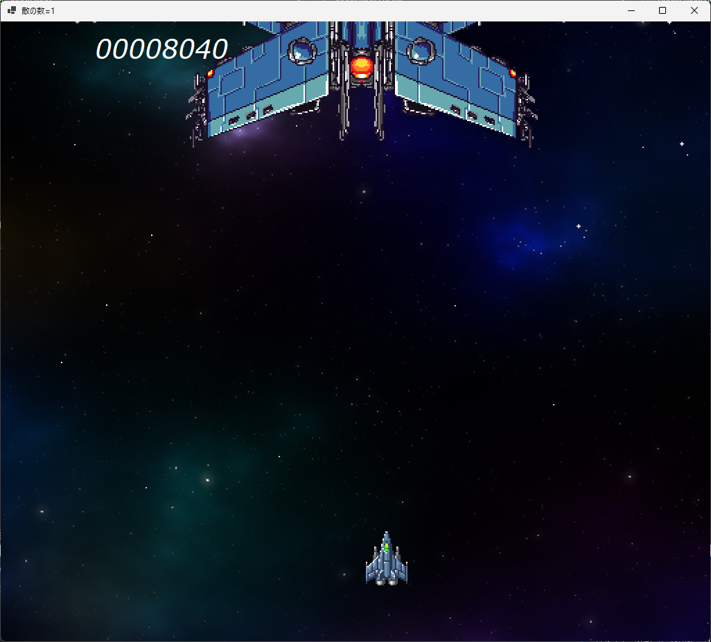</div>

### 3.5 上下移動にかかる秒数を変える

現在、1回の左右移動と上下移動は、どちらも`8.0f`秒かかります。<br>
**上下移動の秒数を、左右移動と違う値にする** と、また違った動きが作れます。<br>
例えば、上下移動の秒数を左右移動の半分にしてみましょう。

ボスを上下に移動するプログラムに、秒数の変数`a`を半分にするプログラムを追加してください。

```diff
           // ボスを左右に移動
           float t = Timer - downEndTime;
           float a = 8.0f;   // 1回の左右移動にかかる秒数
           float b = 256.0f; // 振幅
           Character.X = baseX + MathF.Sin(MathF.PI * 2.0f / a * t) * b;

           // ボスを上下に移動
+          a = 4.0f;  // 1回の上下移動にかかる秒数
           b = 64.0f; // 上下の振幅
           Character.Y = baseY - b + MathF.Cos(MathF.PI * 2.0f / a * t) * b;
         }
       }
```

プログラムが書けたら`>ShootEmUp`ボタンをクリックしてアプリを実行してください。<br>
ボスキャラの動きが「楕円の下半分の形」になっていたら成功です。

<pre class="tnmai_assignment">
<strong>【課題02 上下移動にかかる秒数を変える】</strong>
左右移動と上下移動の秒数を、以下のA～Dのいずれかの組み合わせに変更しなさい。
  <table><tr><th></th><th>左右</th><th>上下</th></tr>
  <tr><th>組み合わせA</th><td>8.0f</td><td>2.0f</td></tr>
  <tr><th>組み合わせB</th><td>9.0f</td><td>3.0f</td></tr>
  <tr><th>組み合わせC</th><td>9.0f</td><td>1.5f</td></tr>
  <tr><th>組み合わせD</th><td>10.0f</td><td>4.0f</td></tr></table>
</pre>

### 3.6 砲塔の座標を変えられるようにする

ボスキャラなのに、攻撃手段が他の敵と同じ「弾丸を１発ずつ撃つ」なのは弱すぎます。<br>
プレイヤーはボスキャラを見たら、ボスらしい多彩な攻撃をしてくることを期待するでしょう。<br>
そこで、ボスキャラの砲塔を増やしてより多くの弾丸を撃ってくるようにしましょう。

ところで、現在の砲塔クラスは、常に敵の座標から弾丸を発射します。<br>
「敵の座標 = 画像の中心」なので、常に画像の中心から弾丸が発射されることになります。<br>
小型や中型の敵であれば、中心から発射できれば十分かもしれません。

ですが、ボスのように画像の大きいキャラの場合、発射位置を変更できるほうが多彩な攻撃を作れます。

そこで、「画像の中心以外から弾丸を発射できる機能」を、砲塔クラスに追加しましょう。<br>
必要なのは、「敵の座標から見た砲塔の相対座標」です。<br>
X軸方向の相対座標の名前は`X`(エックス)、Y軸方向の相対座標の名前は`Y`(ワイ)とします。

`Turret.cs`を開き、変数の宣言に、相対座標をあらわす変数`X`と`Y`を追加してください。

```diff
     public Character? Target; // 攻撃目標
     public int Count;         // 発射数
     public float AngleStart;  // 発射開始角度(ラジアン)
     public float AngleChange; // 角度変化量(ラジアン)
+    public float X; // 発射位置の相対X座標
+    public float Y; // 発射位置の相対Y座標

     // コンストラクタ
     public Turret(float interval, float speed, Character? target,
       int count, float start, float change)
```

次に、コンストラクタに相対座標を`0.0f`で初期化するプログラムを追加してください。

```diff
       BulletSpeed = speed;
       Timer = 0.0f;
       Target = target;
       Count = count;
       AngleStart = start;
       AngleChange = change;
+      X = 0.0f;
+      Y = 0.0f;
     } // コンストラクタブロックの終わり
```

相対座標が`(0, 0)`の場合、これまでどおり「画像の中心」から弾丸が発射されます。

それでは、相対座標を加えた砲塔の座標を計算し、その座標から弾丸を発射しましょう。<br>
砲塔の座標をあらわす変数の名前は、`turretX`(ターレット・エックス)と`turretY`(ターレット・ワイ)とします。

`Update`メソッドにある「発射タイマーの時間を戻す」プログラムの下に、砲塔の座標を計算するプログラムを追加してください。

```diff
       // 発射タイマーの時間を戻す
       Timer += Interval;
+
+      // 砲塔の座標を計算
+      float turretX = character.X + X;
+      float turretY = character.Y + Y;

       // 発射角度を計算
       float angle = 0.5f * MathF.PI; // 攻撃目標がない場合、下向きに撃つ
```

計算した座標を使うように、発射角度の計算と弾丸発射プログラムを変更しましょう。<br>
発射角度を計算するプログラムを、砲塔の座標を使うように変更してください。

```diff
       // 発射角度を計算
       float angle = 0.5f * MathF.PI; // 攻撃目標がない場合、下向きに撃つ
       if (Target != null)
       {
         // 攻撃目標がある場合、攻撃目標に向かう角度を計算
-        float dx = Target.X - character.X; // 敵から攻撃目標までの距離(X軸方向)
-        float dy = Target.Y - character.Y; // 敵から攻撃目標までの距離(Y軸方向)
+        float dx = Target.X - turretX; // 敵から攻撃目標までの距離(X軸方向)
+        float dy = Target.Y - turretY; // 敵から攻撃目標までの距離(Y軸方向)
         angle = MathF.Atan2(dy, dx);
       }
```

続いて、弾丸を発射するプログラムを、砲塔の座標を使うように変更してください。

```diff
         // 弾丸の速度を計算
         float sx = MathF.Cos(angle) * BulletSpeed;
         float sy = MathF.Sin(angle) * BulletSpeed;

         // 弾丸を発射
-        bulletList.Add(new(character.X, character.Y, sx, sy, Bullet.EnemyBullet));
+        bulletList.Add(new(turretX, turretY, sx, sy, Bullet.EnemyBullet));
         angle += AngleChange; // 次の弾丸の発射角度を計算
       }
     } // Update メソッドブロックの終わり
   } // Turret 型ブロックの終わり
```

これで、砲塔の相対座標を考慮して、弾丸が発射されるようになりました。

### 3.7 ボスキャラに砲塔を増やす

砲塔の新機能を、ボスキャラで試しましょう。<br>
`Enemy.cs`を開き、コンストラクタにあるボスキャラを作るプログラムに、砲塔を作るプログラムを追加してください。

```diff
       else if (Type == Boss1)
       {
         Character = new Character(Form1.RenderWidth * 0.5f, -256.0f, animeBoss1, 0);
         HitboxLocal = new(-240, 240, -96, 96); // キャラ中心の衝突判定
         Hp = 800; // ５連装x秒間８連射のとき20秒で倒せる耐久値
         MoveSpeedY = 200; // 下へ移動
+
+        // 16方向に弾丸を撃つ砲塔を、中央左に追加
+        Turret t1 = new(3.0f, 400.0f, null, 16, 0, 2.0f * MathF.PI / 16.0f);
+        t1.X = 92.0f;
+        t1.Y = -32.0f;
+        TurretList.Add(t1);
+
+        // 16方向に弾丸を撃つ砲塔を、中央右に追加
+        Turret t2 = new(3.0f, 400.0f, null, 16, 0, 2.0f * MathF.PI / 16.0f);
+        t2.X = -92.0f;
+        t2.Y = -32.0f;
+        TurretList.Add(t2);
       }

       // 実際のヒットボックスを計算
       Hitbox = new(
```

円周を16分割した方向に発射するために、`Turret`コンストラクタの「角度変化量」は`2π / 16`に設定します。

> `2π`は「弧度(ラジアン)法の円周の長さ」で、「度数法の360度」に対応します。

プログラムが書けたら`>ShootEmUp`ボタンをクリックしてアプリを実行してください。<br>
ボスキャラの左右２ヶ所から、16方向に弾丸が発射されたら成功です。

<div align="center">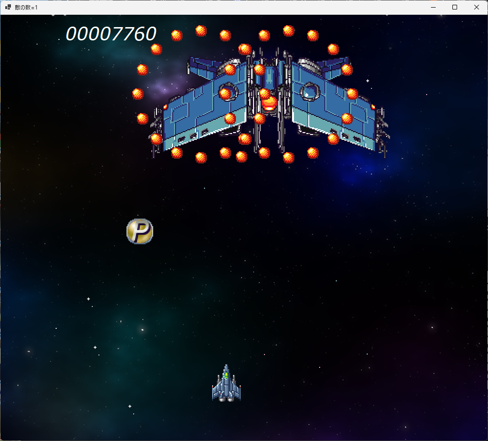</div>

### 3.8 HPが減ってきたら砲塔を増やす

ボスキャラとの先頭は、５発同時発射までパワーアップしていても20秒かかります。<br>
ですが、同じ攻撃を20秒避け続けるのはあまり面白くありません。<br>
そこで、ボスキャラのHPが半分になったら、砲塔を追加して攻撃力を強化しましょう。

ボスキャラの左右の翼のような部分に３つずつ、合計で６個の砲塔を追加します。<br>
各砲塔は１発だけ弾を発射します。<br>
`Update`メソッドの`Boss1`を更新するプログラムに、次のプログラムを追加してください。

```diff
           // ボスを上下に移動
           a = 3.0f;  // １回の上下移動にかかる秒数
           b = 64.0f; // 上下の振幅
           Character.Y = baseY - b + MathF.Cos(MathF.PI * 2.0f / a * t) * b;
+
+          // HPが半分以下になったら、左右の翼に砲塔を追加する
+          // 既に砲塔を追加済の場合は何もしない
+          if (turretList.Count == 3 && Hp <= 400)
+          {
+            Character? target = TurretList[0].Target;
+            for (int c = 0; c < 3; c += 1)
+            {
+              Turret t1 = new(2.0f, 500.0f, target, 1, 0, 0));
+              t1.X = 128.0f + c * 32.0f;
+              t1.Y = 56.0f;
+              TurretList.Add(t1);
+
+              Turret t2 = new(2.0f, 500.0f, target, 1, 0, 0));
+              t2.X = -128.0f - c * 32.0f;
+              t2.Y = 56.0f;
+              TurretList.Add(t2);
+            }
+          } // ifブロック(条件:HP半分以下)の終わり
         }
       }

       // 砲塔の状態を更新
       for (int a = 0; a < TurretList.Count; a += 1)
```

プログラムが書けたら`>ShootEmUp`ボタンをクリックしてアプリを実行してください。<br>
ボスキャラを攻撃し続けると、しばらくして両翼から弾丸が発射されはじめたら成功です。

> プレイヤーの`Init`メソッドで、ショットレベルを`4`にしておくと確認しやすいでしょう。<br>
> 確認が終わったら、忘れずにショットレベルを`0`に戻すこと。

<div align="center">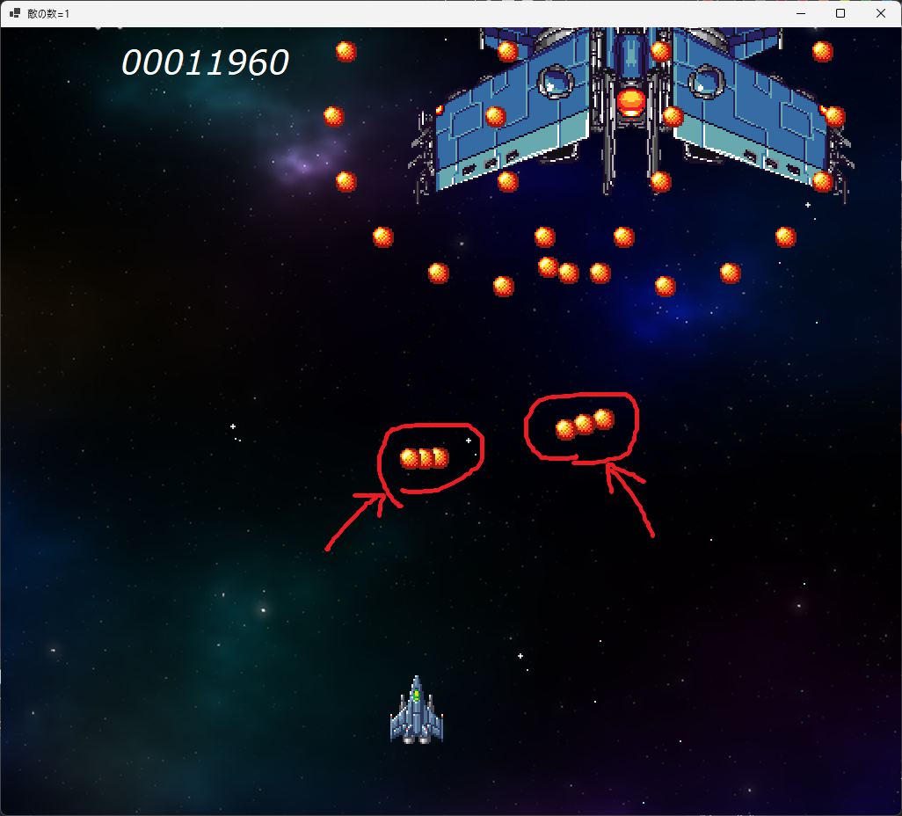</div>

### 3.9 弾丸の発射間隔をずらす

ボスキャラを特徴づけるのは、 **プレイヤーに強い印象を与える個性的な攻撃方法** です。<br>
個性的な攻撃方法は、簡単な工夫で作り出せます。

例として、追加の砲塔の発射タイミングをずらしてみましょう。<br>
これは、砲塔のタイマーを少しずつ変えることで実現できます。<br>
「左右の翼に砲塔を追加する」プログラムに、次のプログラムを追加してください。

```diff
             Character? target = TurretList[0].Target;
             for (int c = 0; c < 3; c += 1)
             {
               Turret t1 = new(2.0f, 500.0f, target, 1, 0, 0));
               t1.X = 128.0f + c * 32.0f;
               t1.Y = 56.0f;
+              t1.Timer = c * 0.1f;
               TurretList.Add(t1);
 
               Turret t2 = new(2.0f, 500.0f, target, 1, 0, 0));
               t2.X = -128.0f - c * 32.0f;
               t2.Y = 56.0f;
+              t2.Timer = c * 0.1f;
               TurretList.Add(t2);
             }
           } // ifブロック(条件:HP半分以下)の終わり
```

プログラムが書けたら`>ShootEmUp`ボタンをクリックしてアプリを実行してください。<br>
両翼から発射される弾丸が、少しずつタイミングをずらして発射されたら成功です。

<div align="center">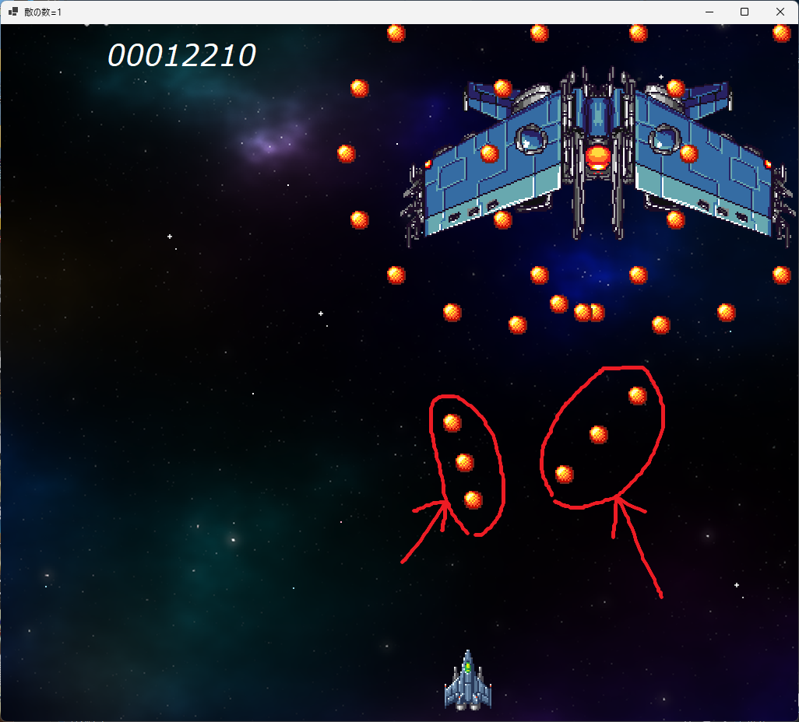</div>

<pre class="tnmai_assignment">
<strong>【課題03 HPが1/4以下になったら砲塔を追加する】</strong>
ボスキャラのHPが1/4以下になったとき、新しい砲塔を２つ追加しなさい。
砲塔の仕様は以下のとおりです。

  右側の砲塔の座標: (224, 80)
  左側の砲塔の座標: (-224, 80)

  左右共通の仕様
    発射間隔:   1.5秒
    弾丸の速度: 秒速500ドット
    ターゲット: 0番目の砲塔と同じターゲットを狙う
    同時発射数: 3発
    初期角度:  -0.5ラジアン
    角度変化量: 0.5ラジアン
    タイマーの初期値: 0秒
</pre>

<div style="page-break-after: always"></div>

## 4 レベルを増やす

### 4.1 ボスキャラを倒したらクリア状態にする

ボスキャラはレベルの最後に登場します。そして、ボスキャラを倒せば、そのレベルは終了です。<br>
ボスキャラを倒したら、ゲームを「クリア状態」にしましょう。

「クリア状態にする」方法はいくつか考えられますが、今回は以下の方法を使います。

> 1. 倒した敵の種類が`Boss1`だった場合、クリア状態にするまでの「待ち時間」を設定する
> 2. 「待ち時間」が設定されていたら、待ち時間を減らす
> 3. 2で「待ち時間」を減らした結果、「待ち時間」が0以下になったらクリア状態にする

それでは、「待ち時間」をあらわす変数を作りましょう。<br>
名前は`levelClearTimer`(レベル・クリア・タイマー、「レベルクリア状態にするタイマー」という意味)とします。

`Form1`を開き、「自機の変数」に`levelClearTimer`変数の宣言を追加してください。

```diff
     // 自機の変数
     private Player player = new(RenderWidth * 0.5f, RenderHeight * 0.75f);
     private List<Bullet> playerBulletList = new();
     private List<Item> itemList = new();
     private int score = 0; // 得点
+    private float levelClearTimer = 0.0f; // クリア状態にするまでの残り時間

     // 爆発などのエフェクトのリスト
     private List<Character> effectList = new();
```

次に、「HPが0以下になった敵を破壊する」if文の中に、`levelClearTimer`を設定するプログラムを追加してください。

> 以下のプログラムは、課題の進め方によって違う部分があると思います。<br>
> 細かい違いはあまり気にしないでください。

```diff
           // HPが0以下になった敵を破壊する
           if (enemy.Hp <= 0)
           {
             score += enemy.GetScore(); // 得点を増やす
             enemy.IsFinished = true; // 敵を終了状態にする
+
+            // 倒したのがボスキャラなら、「クリア状態にするまでの待ち時間」を設定する
+            if (enemy.Type == Enemy.Boss1)
+            {
+              levelClearTimer = 4.0f; // 爆発の終了待ちと、倒した後の余韻の時間を持たせる
+            }

             // 爆発エフェクトを追加する
             if (enemy.Type == Enemy.MediumBlue || enemy.Type == Enemy.MediumRed)
             {
               Character c = new(enemy.Character.X, enemy.Character.Y, animeMediumBlast, 10);
```

続いて、「待ち時間」を減らして、「待ち時間が0以下になったらクリア状態にするプログラム」を追加します。<br>
敵と自機の弾丸の衝突判定を行うプログラムの下に、次のプログラムを追加してください。

```diff
         } // playerBulletList のforブロックの終わり
       } // enemyList のforブロックの終わり
       playerBulletList.RemoveAll((e) => { return e.IsFinished; });
       enemyList.RemoveAll((e) => { return e.IsFinished; });
+
+      // レベルクリアタイマーが0より大きい場合、タイマーを減らす
+      // 減らした結果、タイマーが0になったらクリア状態にする
+      if (levelClearTimer > 0.0f)
+      {
+        levelClearTimer -= deltaTime;
+        if (levelClearTimer <= 0.0f)
+        {
+          gameState = gsClear; // クリア状態にする
+        }
+      }

       // 自機と敵の弾の衝突判定
       for (int a = 0; a < enemyBulletList.Count; a += 1)
```

これで、ボスキャラを倒したらクリア状態に変わるはずです。

プログラムが書けたらアプリを実行して⋯と行きたいところですが、レベルクリアタイマーのプログラムは、ボスキャラを倒さないと機能しません。
ですが、ボスキャラを倒すのは大変時間がかかります。そこで、ボスキャラのHPを減らします。

`Enemy.cs`を開き、コンストラクタにある`Boss1`を作成するプログラムを、次のように変更してください。

```diff
       else if (Type == Boss1)
       {
         Character = new Character(Form1.RenderWidth * 0.5f, -256.0f, animeBoss1, 0);
         HitboxLocal = new(-240, 240, -96, 96); // キャラ中心の衝突判定
-        Hp = 800; // ５連装x秒間８連射のとき20秒で倒せる耐久値
+        Hp = 10; // ５連装x秒間８連射のとき20秒で倒せる耐久値
         MoveSpeedY = 200; // 下へ移動

         // 16方向に弾丸を撃つ砲塔を、中央左に追加
         Turret t1 = new(3.0f, 400.0f, null, 16, 0, 2.0f * MathF.PI / 16.0f);
```

プログラムが書けたら`>ShootEmUp`ボタンをクリックしてアプリを実行してください。<br>
ボスキャラに10発打ち込むと破壊できて、少し待つと何も無いクリア画面が表示されたら成功です。

<div align="center">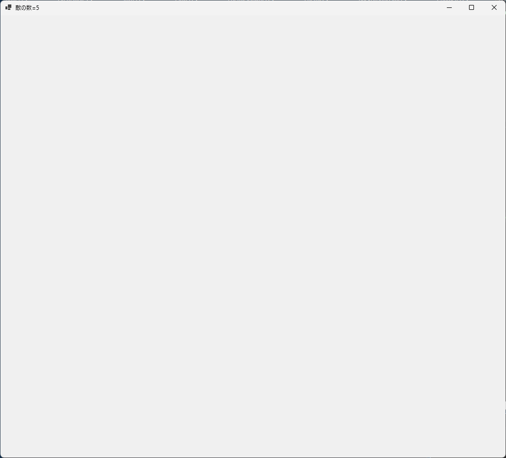</div>

### 4.2 クリア状態を表示する

レベルをクリアしたことが分かるように、クリア画面に画像と文字を表示しましょう。<br>
まずはクリア画面用のフォントを準備します。

フォント変数の名前は`fontClear`(フォント・クリア、「クリア画面のフォント」という意味)とします。
`Form1`の「フォント変数」の宣言に、次のプログラムを追加してください。

```diff
     // フォント変数
     private Font fontHeading = null !; // 見出し用フォント
     private Font fontScore = null !;   // 得点用フォント
+    private Font fontClear = null !;   // レベルクリア表示用フォント

     // ファイルから画像を読み込む
     private Bitmap bmpBackground = new("assets/images/bg_space.png");
     private Bitmap bmpObjects = new("assets/images/tile_objects.png");
```

次に、`Init`メソッドにある「フォントを作成」するプログラムに、クリア画面用のフォントを作成するプログラムを追加してください。

```diff
       // フォントを作成
       float dpiScale = 96.0f / DeviceDpi;
       fontHeading = new("Impact", 64 * dpiScale);
       fontScore = new("Verdana", 28 * dpiScale, FontStyle.Italic);
+      fontClear = new("Verdana", 64 * dpiScale, FontStyle.Bold | FontStyle.Italic);

       // 背景のY座標を、一番下の1画面がちょうどウィンドウ内に表示されるように設定
       backgroundY = -(bmpBackground.Height - RenderHeight);
     } // Init メソッドブロックの終わり
```

作成したフォントを使ってクリア画面を表示しましょう。<br>
`PaintClear`メソッドに、次のプログラムを追加してください。

```diff
     // クリア状態を描く
     private void PaintClear(Graphics g)
     {
+      PaintPlay(g);
+      TextRenderer.DrawText(
+        g, "LEVEL CLAER!", fontClear, new Point(160, 400), Color.LightBlue);
     } // PaintClear メソッドブロックの終わり

     // 死亡状態を描く
     private void PaintDead(Graphics g)
```

プログラムが書けたら`>ShootEmUp`ボタンをクリックしてアプリを実行してください。<br>
ボスキャラを破壊した後、画像と文字付きのクリア画面が表示されたら成功です。

<div align="center">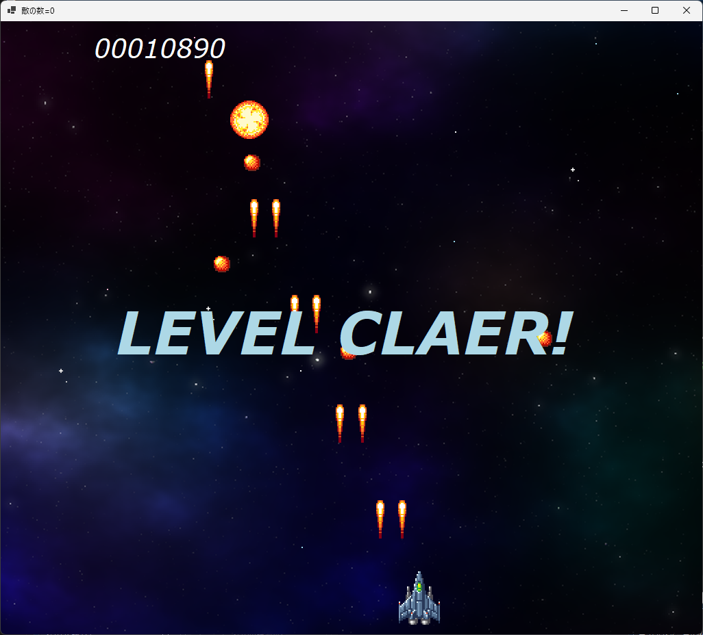</div>

### 4.3 ゲームを再開できるようにする

クリア画面からゲームを再開できるようにしましょう。<br>
クリア画面では、死亡状態と同じようにデータを初期化します。

初期化のようなプログラムは、ひとつの場所にまとまっていることが重要です。<br>
「コピー&貼り付け」で作ると、初期化する変数の追加や変更が起きたとき、コピペ先をひとつでも書き直し忘れるとバグになるからです。

初期化をひとつの場所にまとめるために、初期化用のメソッドを作ります。<br>
メソッド名は`InitLevelData`(イニット・レベル・データ、「レベルのデータを初期化する」という意味)とします。

今回は、`UpdateDead`にあるデータ初期化プログラムを流用して、メソッドを作ります。<br>
`UpdateDead`メソッドの一部を、`InitLevelData`メソッドに分解してください。

```diff
     // 死亡状態を更新する
     //   deltaTime  状態を進める秒数
     private void UpdateDead(float deltaTime)
     {
       if (GetAsyncKeyState(vkReturn) < 0)
       {
+        InitLevelData();
+
+        player.ShotLevel = 0; // 自機のレベルをリセットする
+        score = 0; // 得点をリセットする
+
+        gameState = gsPlay; // ゲームを開始する
+      }
+    } // UpdateDead メソッドブロックの終わり
+
+    // レベルデータを初期化する
+    private void InitLevelData()
+    {
         // 敵のデータを初期化する
         enemyList.Clear();
         enemySpawnerList.Clear();
         enemyBulletList.Clear();

         // 自機のデータを初期化する
         player.Character.X = RenderWidth * 0.5f;
         player.Character.Y = RenderHeight * 0.75f;
-        player.ShotLevel = 0;
         playerBulletList.Clear();
-        score = 0; // 得点をリセットする

         // その他のデータを初期化する
         itemList.Clear();
         effectList.Clear();
         backgroundY = -(bmpBackground.Height - RenderHeight);
-
-        gameState = gsPlay; // ゲームを開始する
-      }
-    } // UpdateDead メソッドブロックの終わり
+    } // InitLevelData メソッドブロックの終わり

     // プレイ状態を描く
     private void PaintPlay(Graphics g)
```

このように、条件が許せば、既存のメソッドを２つのメソッドに分解できます。<br>
また、死亡状態とクリア状態で扱いが異なる変数は、`InitLevelData`メソッドの外で個別に初期化します。

次に、`UpdateClear`メソッドに次のプログラムを追加してください。

```diff
     // クリア状態を更新する
     //   deltaTime  状態を進める秒数
     private void UpdateClear(float deltaTime)
     {
+      if (GetAsyncKeyState(vkReturn) < 0)
+      {
+        InitLevelData();
+
+        gameState = gsPlay; // ゲームを開始する
+      }
     } // UpdateClear メソッドブロックの終わり

     // 死亡状態を更新する
     //   deltaTime  状態を進める秒数
```

クリア状態からのゲーム再開では、自機のレベルと得点は引き継ぎたいので初期化しません。

プログラムが書けたら`>ShootEmUp`ボタンをクリックしてアプリを実行してください。<br>
クリア画面で`Enter`キーを押したとき、ゲームが再開されたら成功です。

<div align="center">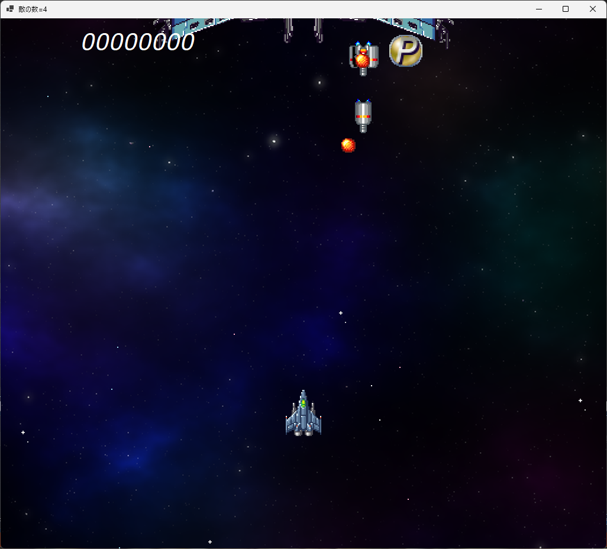</div>

### 4.4 新しいレベルを作る

レベルをクリアできるようになると、同じレベルが繰り返されるだけでは飽きてしまいます。<br>
そこで、新しいレベルを追加しましょう。「新しいレベル」を作るには、以下のデータが必要です。

* 現在のレベルをあらわす変数
* レベルの背景の画像
* レベルのイベント表

それでは、「現在のレベルをあらわす変数」から作りましょう。<br>
変数名は`gameLevel`(ゲーム・レベル)とします。<br>
`Form1`を開き、「自機の変数」の宣言に、ゲームレベルをあらわす変数を追加してください。

```diff
     private Player player = new(RenderWidth * 0.5f, RenderHeight * 0.75f);
     private List<Bullet> playerBulletList = new();
     private List<Item> itemList = new();
     private int score = 0; // 得点
     private float levelClearTimer = 0.0f; // クリア状態にするまでの残り時間
+    private int gameLevel = 0; // 現在プレイ中のレベル

     // 爆発などのエフェクトのリスト
     private List<Character> effectList = new();
```

### 4.5 背景の画像を増やす

次に「レベルの背景の画像」を増やします。<br>

1. 背景の画像ファイル名を配列にする
2. `InitLevelData`メソッドで、レベルに対応する背景を読み込む

「背景の画像ファイル名の配列」の名前は`bgFilenameList`(ビージー・ファイルネーム・リスト、「背景のファイル名のリスト」)とします。<br>
`bg`は、`background`(バック・グラウンド、「背景」という意味)の短縮形です。

背景の変数を宣言するプログラムを、次のように変更してください。

```diff
     private Font fontScore = null!;   // 得点用フォント
     private Font fontClear = null!;   // レベルクリア表示用フォント

     // ファイルから画像を読み込む
-    private Bitmap bmpBackground = new("assets/images/bg_space.png");
+    private Bitmap bmpBackground = null !;
     private Bitmap bmpObjects = new("assets/images/tile_objects.png");
+
+    // 背景の画像ファイル名のリスト
+    private static readonly string[] bgFilenameList = {
+      "bg_space.png",
+      "bg_frontline.png",
+    };

     // 敵の変数
     private List<Enemy> enemyList = new();
     private List<Bullet> enemyBulletList = new(); // 敵の弾丸のリスト
```

続いて、`InitLevelData`メソッドにある「その他のデータを初期化する」プログラムを、次のように変更してください。

```diff
       // その他のデータを初期化する
       itemList.Clear();
       effectList.Clear();
+
+      // 現在のレベルに対応する画像ファイルを読み込む
+      string bgFilename = bgFilenameList.Last(); // 最後の画像ファイル名を選択
+      if (gameLevel < bgFilenameList.Length)
+      {
+        bgFilename = bgFilenameList[gameLevel];
+      }
+      bmpBackground = new Bitmap("assets/images/" + bgFilename);

       // 背景のY座標を、一番下の1画面がちょうどウィンドウ内に表示されるように設定
       backgroundY = -(bmpBackground.Height - RenderHeight);
     } // InitLevelData メソッドブロックの終わり
```

`bmpBackground`変数の初期値を`null`にしたので、ゲームが始まる前に画像を読み込んでおく必要があります。<br>
これは、`Init`メソッドで`InitLevelData`を呼び出せば解決します。<br>
`Init`メソッドの背景のY座標を設定するプログラムを、`InitLevelData`メソッドの呼び出しで書き換えてください。

```diff
       // フォントを作成
       float dpiScale = 96.0f / DeviceDpi;
       fontHeading = new("Impact", 64 * dpiScale);
       fontScore = new("Verdana", 28 * dpiScale, FontStyle.Italic);
       fontClear = new("MS Gothic", 64 * dpiScale, FontStyle.Italic);

-      // 背景のY座標を、一番下の1画面がちょうどウィンドウ内に表示されるように設定
-      backgroundY = -(bmpBackground.Height - RenderHeight);
+      InitLevelData();
     } // Init メソッドブロックの終わり
```

`backgroundY`の初期化を削除したのは、`InitLevelData`メソッドに同じプログラムがあるからです。<br>
`Init`メソッドから`InitLevelData`を呼び出すようにしたので、`Init`側のプログラムは削除できます。

それから、レベルをクリアしたときに現在のレベルを1増やします。<br>
`UpdateClear`メソッドに、現在のレベルを1増やすプログラムを追加してください。

```diff
     private void UpdateClear(float deltaTime)
     {
       if (GetAsyncKeyState(vkReturn) < 0)
       {
+        gameLevel += 1; // 次のレベルに進む
         InitLevelData();
 
         gameState = gsPlay; // ゲームを開始する
```

プログラムが書けたら`>ShootEmUp`ボタンをクリックしてアプリを実行してください。<br>
クリア画面で`Enter`キーを押したとき、背景が変化したら成功です。

<div align="center">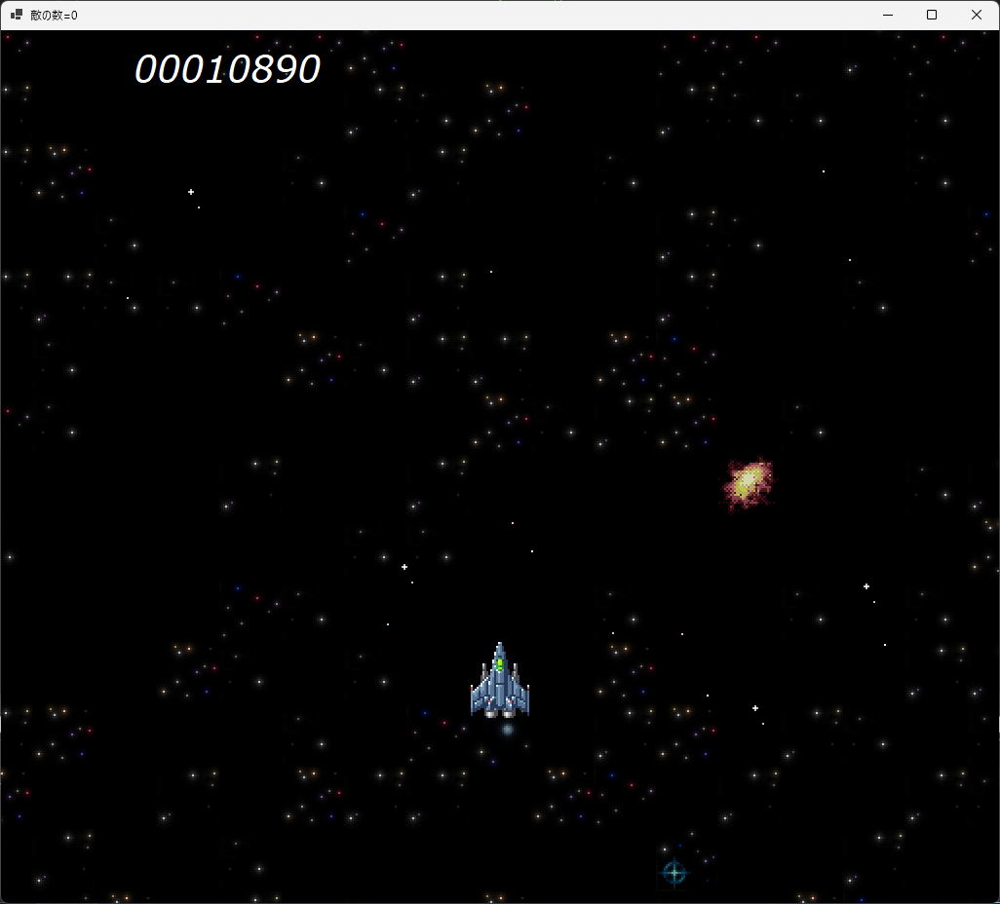</div>

### 4.6 イベント表を増やす

背景だけ変えても、同じ敵が同じ順番で出てくるのではすぐ飽きるのは変わりません。<br>
レベルごとに異なるイベント表を使うように、`EventTable`クラスに以下のデータを追加します。

* 新しいイベント表
* イベント表のリスト
* 現在のレベルをあらわす変数

新しいイベント表の名前は`tableLevelOne`(テーブル・レベル・ワン、「レベル1の表」という意味)とします。<br>
イベント表のリストの名前は`tableList`(テーブル・リスト、「表のリスト」という意味)とします。<br>
現在のレベルをあらわす変数の名前は`Level`(レベル)とします。

レベル0のイベント表`tableLevelZero`の宣言の下に、次のプログラムを追加してください。

```diff
+
+    // レベル1のイベント表
+    private static readonly int[,] tableLevelOne = {
+      {  100, -1,  4, -1,  4, -1 },
+      {  300,  4, -1, -1, -1,  4 },
+      {  500, -1, -1,  4, -1, -1 },
+      {  700, -1,  3, -1, -1, -1 },
+      {  900, -1, -1, -1,  3, -1 },
+      { 1100, -1, -1,  5,  3, -1 },
+    };
+
+    // イベント表のリスト
+    private static readonly int[][,] tableList = {
+      tableLevelZero,
+      tableLevelOne,
+    };

+    public int Level; // 現在のレベル
     public int Index; // 参照する行の番号
     public Random rand = new(); // 乱数
```

次に、コンストラクタで`Level`変数を初期化してください。

```diff
     public int Index; // 参照する行の番号
     public Random rand = new(); // 乱数

     // コンストラクタ
     {
+      Level = 0;
       Index = 0;
       Rand = new();
     } // コンストラクタブロックの終わり
```

続いて、`Update`メソッドにある「イベント表を選択」するプログラムを、`tableList`を使うように変更してください。

```diff
     // 敵発生表の状態を更新する
     public void Update(float y, List<EnemySpawner> enemySpawnerList)
     {
       // イベント表を選択
-      int[,] table = tableLevelZero;
+      int[,] table = tableList.Last(); // リストの最後の表を選択
+      if (Level < tableList.Length)
+      {
+        table = tableList[Level];
+      }

       // スクロール座標が現在の行のY座標未満なら何もしない
       if (y < table[Index, 0])
```

最後に、クリア状態と、死亡状態のときに、`Level`変数と`Index`変数を設定します。<br>
`Form1`を開き、`InitLevelData`メソッドに次のプログラムを追加してください。

```diff
       // 敵のデータを初期化する
       enemyList.Clear();
       enemySpawnerList.Clear();
       enemyBulletList.Clear();
       levelClearTimer = 0.0f;
+      eventTable.Level = gameLevel;
+      eventTable.Index = 0;
 
       // 自機のデータを初期化する
       player.Character.X = RenderWidth * 0.5f;
       player.Character.Y = RenderHeight * 0.75f;
```

これで、レベルに対応するイベント票が使われるようになりました。

プログラムが書けたら`>ShootEmUp`ボタンをクリックしてアプリを実行してください。<br>
クリア画面で`Enter`キーを押したとき、背景だけでなく発生する敵も変化したら成功です。

<div align="center"></div>

<pre class="tnmai_assignment">
<strong>【課題04 ボスキャラの発生位置をレベルの最後にする】</strong>
<code>EventTable.cs</code>にある<code>tableLevelZero</code>について、
ボスキャラの発生位置を、次のように変更しなさい。
  ・Y座標100で登場するボスのパターン番号99番を、パターン番号１番に変更
  ・Y座標2600の行を追加し、中央にボスのパターン番号99番を配置(残りは-1にする)
</pre>

<pre class="tnmai_assignment">
<strong>【課題05 大きな爆発アニメーションを作る】</strong>
<code>Form1</code>に、大きな爆発のアニメーション範囲の変数を追加しなさい。

  アニメーション範囲の変数名: <code>animeBigBlast</code>
  アニメーション範囲:
    (560, 480, 32, 32), (592, 464, 48, 48), (640, 448, 64, 64),
    (704, 416, 96, 96), (800, 400, 112, 112), (912, 400, 112, 112),
  秒間アニメーション枚数: 8
</pre>

<pre class="tnmai_assignment">
<strong>【課題06 ボスキャラを倒したとき、大きな爆発を表示する】</strong>
<code>Form1</code>にある「爆発エフェクトを追加する」プログラムについて、
if文を使って「敵の種類が<code>Boss1</code>の場合、大きな爆発を表示する」プログラムを追加しなさい。
</pre>

<pre class="tnmai_assignment">
<strong>【課題07 レベル1のイベント表を完全なものにする】</strong>
レベル1のイベント表<code>tableLevelOne</code>に、Y座標200ドットごとに行を追加して、
レベル0より少し難しいレベルを完成させなさい。
</pre>

<pre class="tnmai_assignment">
<strong>【課題08 効果音、BGMを再生する】</strong>
NuGetを使って<code>SFML.Audio</code>パッケージを追加し、効果音やBGMを再生しなさい。
  - 効果音: 自機が弾丸を発射したとき、爆発を作るとき、パワーアップしたとき
  - BGM: プレイ中、クリア、死亡
</pre>

<pre class="tnmai_assignment">
<strong>【課題09 さらに要素を追加する】</strong>
以下の要素を、できる限り多くゲームに追加しなさい。
  - タイトル画面を追加する
  - タイトル画面でEnterキーを押したとき、効果音を鳴らす
  - 見た目の異なる弾丸を作り、ボスキャラの16方向弾の見た目を変える
  - 新しい敵その１(小型、画面の上から発生し、真下に画面3/4ほど移動して真上に戻る、画像は任意)
  - 新しい敵その２(小型、画面の左右から発生し、横向きU字ターンで移動、画像は任意)
  - レベル1用の新しいボスキャラを作る(敵番号は任意、パターン番号は98とする)
    画像はWebで探して、<code>tile_objects.png</code>の空き領域に貼り付けて使う
  - 最終レベルクリア後にゲームクリア画面を表示する
  - レベル2を作る
  - レベル3を作る
</pre>
